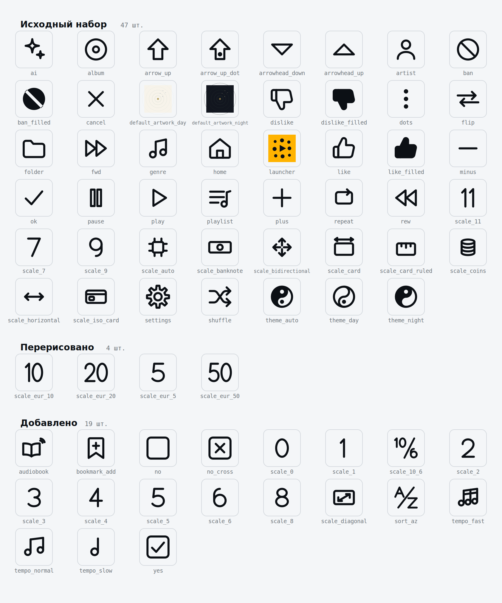
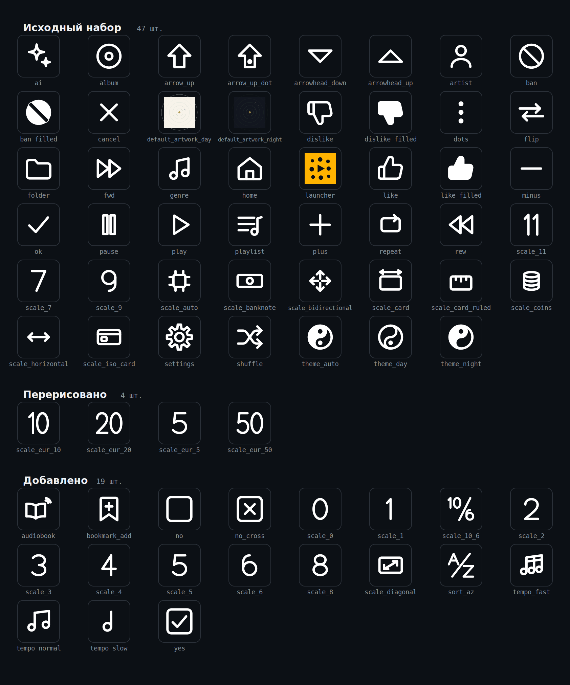

# Riff icon system contract — 1. Normative artifacts and precedence

> Owner/scope: bounded section of Riff/LATEST/icon-system

## 1. Normative artifacts and precedence

The 93 exact general icon sources under references/drawable are the adopted default/day corpus. The
67 files supplied with explicit Night artwork have exact qualified peers under
references/drawable-night. Exact copies are packaged as ordinary Android VectorDrawable resources
under app/src/main/res/drawable and app/src/main/res/drawable-night and are not user-configurable.
The adopted `iconset_daynight.tar.xz`, SHA-256
`b4ad5d0f72cb3f05914f94d416cb7db92174214076e03d7f81d127eaeda72376`, and its Day/Night contact sheets
are retained under references/drawable/icon-system. The exact style prompt at
references/drawable/icon-system/riff-icon-style-prompt.md has SHA-256
2994710a28f66562e8d4ca11d43d1395a697b2778fbb6a8aecbea7c71540038a. Retaining the prompt does not
authorize execution. Future modifications require separate explicit adoption before promotion.

The immutable archive's standalone `drawable/ic_launcher.xml` is excluded from the 93-icon corpus
and APK resources. Section 8 owns the adopted launcher. The two default-artwork drawings and 4:3
SMPTE loading drawing have separate owners.

### Adopted 2026-09-18 package

[Download the exact supplied `iconset_daynight.tar.xz` attachment](../../../references/drawable/icon-system/iconset_daynight.tar.xz).

Day preview:

Night preview:

The contact sheets describe the 67 supplied Day/Night pairs; section 8 controls the launcher.

## 2. Fixed icon roster and semantics

The normative set contains 93 Android vector drawables: the following 70 icons plus the 23 exact AZ
sources in section 7:

| Resource              | Required semantic use                                                                                                                   | Resource                 | Required semantic use                                    |
| --------------------- | --------------------------------------------------------------------------------------------------------------------------------------- | ------------------------ | -------------------------------------------------------- |
| `ic_album`            | Albums category                                                                                                                         | `ic_artist`              | Artists category                                         |
| `ic_audiobook`        | Books profile content-mode toggle and Book classification toggle ([Content modes and classification](/Riff/LATEST/player-content-mode)) | `ic_sort_az`             | A-Z alphabetical order and progressive name-search entry |
| `ic_genre`            | Genres category and Music classification toggle                                                                                         | `ic_playlist`            | Playlists category                                       |
| `ic_ai`               | AI/probabilistic selection                                                                                                              | `ic_folder`              | Folders category                                         |
| `ic_flip`             | Switch library/playback                                                                                                                 | `ic_settings`            | Settings                                                 |
| `ic_home`             | Home/root destination                                                                                                                   | `ic_like`                | Like, inactive                                           |
| `ic_like_filled`      | Like, active                                                                                                                            | `ic_dislike`             | Dislike, inactive                                        |
| `ic_dislike_filled`   | Dislike, active                                                                                                                         | `ic_ban`                 | Ban, inactive; Dim Backlight Off                         |
| `ic_ban_filled`       | Ban, active                                                                                                                             | `ic_shuffle`             | Shuffle                                                  |
| `ic_rew`              | Previous/rewind                                                                                                                         | `ic_play`                | Play                                                     |
| `ic_pause`            | Pause                                                                                                                                   | `ic_fwd`                 | Next/forward                                             |
| `ic_repeat`           | Repeat                                                                                                                                  | `ic_plus`                | Increase/add                                             |
| `ic_minus`            | Decrease/remove                                                                                                                         | `ic_dots`                | More options                                             |
| `ic_ok`               | Confirm/accept                                                                                                                          | `ic_cancel`              | Cancel/close                                             |
| `ic_arrow_up`         | Up/expand                                                                                                                               | `ic_arrow_up_dot`        | Up/expand with long-tap marker                           |
| `ic_arrowhead_up`     | Previous page                                                                                                                           | `ic_arrowhead_down`      | Next page                                                |
| `ic_theme_day`        | Theme: force Day                                                                                                                        | `ic_theme_night`         | Theme: force Night                                       |
| `ic_theme_auto`       | Theme: follow Android day/night state                                                                                                   | `ic_scale_7`             | Screen diagonal: 7-inch                                  |
| `ic_scale_9`          | Screen diagonal: 9-inch                                                                                                                 | `ic_scale_11`            | Screen diagonal: 11-inch                                 |
| `ic_scale_diagonal`   | General diagonal screen-measurement reference                                                                                           | `ic_scale_0`             | General scale reference: 0                               |
| `ic_scale_1`          | General scale reference: 1                                                                                                              | `ic_scale_2`             | General scale reference: 2                               |
| `ic_scale_3`          | General scale reference: 3                                                                                                              | `ic_scale_4`             | General scale reference: 4                               |
| `ic_scale_5`          | General scale reference: 5                                                                                                              | `ic_scale_6`             | General scale reference: 6                               |
| `ic_scale_8`          | General scale reference: 8                                                                                                              | `ic_scale_10_6`          | General scale reference: 10.6                            |
| `ic_tempo_slow`       | Perceived speed: slow                                                                                                                   | `ic_tempo_normal`        | Perceived speed: medium                                  |
| `ic_tempo_fast`       | Perceived speed: fast                                                                                                                   | `ic_digit_1`             | User profile 1                                           |
| `ic_digit_2`          | User profile 2                                                                                                                          | `ic_digit_3`             | User profile 3                                           |
| `ic_scale_auto`       | Screen size: trust verified automatic metrics                                                                                           | `ic_scale_card`          | Card calibration                                         |
| `ic_scale_card_ruled` | Alternate Card-calibration outline                                                                                                      | `ic_scale_iso_card`      | ISO/IEC 7810 ID-1 card reference                         |
| `ic_scale_banknote`   | US-banknote reference                                                                                                                   | `ic_scale_coins`         | Coins reference (not a payment action)                   |
| `ic_scale_eur_5`      | Euro-note reference: €5                                                                                                                 | `ic_scale_eur_10`        | Euro-note reference: €10; AI queue length: 10            |
| `ic_scale_eur_20`     | Euro-note reference: €20; AI queue length: 20                                                                                           | `ic_scale_eur_50`        | Euro-note reference: €50; AI queue length: 50            |
| `ic_scale_horizontal` | Horizontal-only scaling diagnostic                                                                                                      | `ic_scale_bidirectional` | Two-axis scaling diagnostic                              |
| `ic_bookmark_add`     | Add a bookmark at the current playback position                                                                                         | `ic_yes`                 | Affirmative/Yes state                                    |
| `ic_no`               | Negative/No state without a cross                                                                                                       | `ic_no_cross`            | Explicit negative/No state with a cross                  |

- UI code MUST use these resources for the listed semantics and MUST NOT substitute downloaded,
  stock, Material, font-glyph, remembered, or independently generated icons.
- The active/inactive pairs `like`, `dislike`, and `ban` MUST switch between their outline and
  filled files without changing layout geometry.
- `ic_arrow_up` and `ic_arrow_up_dot` MUST be interchangeable without shifting layout. The dot marks
  long-tap availability only where a controlling interaction contract permits long tap; it does not
  authorize a long-press-only action.
- `ic_arrowhead_up` and `ic_arrowhead_down` are the required page-navigation pair. They MUST remain
  exact vertical mirrors with the same outer bounds and MUST NOT be replaced by shafted arrows,
  left/right chevrons, or rotated Play icons.
- `ic_theme_day`, `ic_theme_night`, and `ic_theme_auto` are the required SETTINGS_SCREEN
  Theme-choice family. Day uses the light-mass form, Night the heavy-mass form, and Auto the
  combined form. All three retain the same outer circle and bounds; they MUST NOT be replaced by
  sun, moon, text, or unrelated system glyphs.
- `ic_scale_diagonal`, `ic_scale_card`, and `ic_scale_auto` are the required SETTINGS*SCREEN
  Diagonal-source family in that order and MUST be used without visible captions. `ic_digit_1`,
  `ic_digit_2`, and `ic_digit_3` are the required icon-only User-profile family in that order.
  `ic_scale_7`, `ic_scale_9`, `ic_scale_11`, and the other scale-number icons remain general
  references and are not Settings choices. `ic_scale_card_ruled` remains an alternate general
  Card-calibration glyph, not a SETTINGS_SCREEN choice. The retained `ic_tempo*\*` asset identifiers
  carry perceived-speed semantics and create no control or preference.
- CALIBRATION_SCREEN MUST use `ic_scale_card_ruled` for its Card mode, `ic_scale_banknote` for both
  US-note and Euro-note modes, and the exact `ic_scale_eur_5`, `ic_scale_eur_10`, `ic_scale_eur_20`,
  and `ic_scale_eur_50` resources as icon-only Euro denomination choices. `ic_scale_iso_card`, coin,
  and scaling-diagnostic resources remain reserved. None implies payment, purchasing, or a currency
  selector.
- The AI queue-entry surface MUST reuse the exact `ic_scale_eur_10`, `ic_scale_eur_20`, and
  `ic_scale_eur_50` resources as its icon-only `10`, `20`, and `50` queue-length choices in that
  order. This exact dual-context mapping is adopted and is not prohibited repurposing: the same
  bytes retain their Euro-denomination meaning only inside CALIBRATION_SCREEN and carry
  queue-cardinality meaning only inside the AI surface. AI accessibility semantics MUST announce
  queue length and MUST NOT announce Euro, currency, banknote, payment, or purchase meaning. No
  parallel `ic_digit_10`, `ic_digit_20`, `ic_digit_50`, text-glyph, downloaded, stock, remembered,
  or generated substitute is permitted. `ic_scale_eur_5` remains calibration-only.
- An icon MAY be omitted where the controlling screen contract calls for text only. It MUST NOT be
  repurposed for a different or ambiguous action.
- The four newly adopted semantic assets do not independently create controls or behavior:
  `ic_bookmark_add` is reserved for the separately controlled bookmark action; `ic_yes`, `ic_no`,
  and `ic_no_cross` may be used only where the owning screen contract calls for their stated
  affirmative/negative semantics.
- `ic_smpte_bars` is not an icon, action, tint mask, focus target, or accessibility node. Its
  declared `240dp x 180dp` size and `480 x 360` viewport are intentional `4:3` image geometry and do
  not alter the exact 93-icon roster or its `24dp` square-vector rule.
